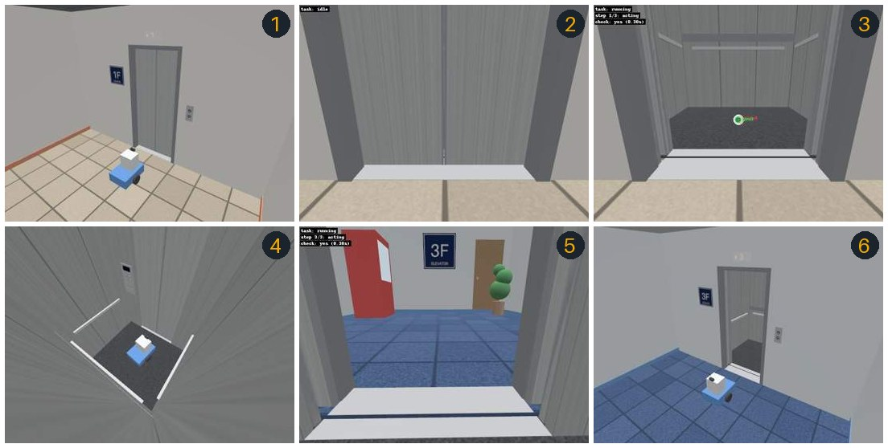

# elevator_vlm

[](https://github.com/mamoru1126/physical_ai_for_mobile_robot/actions/workflows/elevator-sim.yml)

画像と言語の指示で、移動ロボットをエレベーターに乗り降りさせるシミュレーション環境です。



モック VLM での通し実行の画像です（GitHub Actions で実行したもの）。

1. 1階の乗場で、扉の正面 1 m に待機する
2. ロボットのカメラの映像。扉は閉じている
3. 扉が開いた。指差した点（かごの床の中央）へ向かう
4. かごの中で 180 度旋回した
5. 3階で扉が開いた
6. 3階の乗場へ降りた

「扉が開いたら中に入って」「中に入ったら180度旋回して」「再び扉が開いたら出て」の3つを文字で指示し、カメラと車輪オドメトリだけで実行します。構成は[検討資料](https://mamoru1126.github.io/physical_ai_for_mobile_robot/elevator-task/)のとおりで、VLM が「計画」「扉が開いたかの判定」「進む先の指差し」を受け持ち、車輪はオドメトリで制御する小さなスキルが動かします。

- シミュレータ: Gazebo Harmonic（ROS 2 Humble）。土台は omnivla_gazebo の Docker と同じです。
- VLM: Qwen3.5-9B の 4bit 量子化版を vLLM で動かします（約 11 GB）。RTX 3090 1枚で Gazebo と同居できます。
- 世界: 3階建ての建物、両開きの扉のエレベーター（1階で乗り、2階を通過して3階で降りる）、差動二輪のロボット。

## 確認できていること、できていないこと

| 項目 | 状態 |
| --- | --- |
| Docker イメージのビルド | GitHub Actions で確認 |
| 実行系のロジック（単体テスト 48 件、擬似世界での通し試験など 39 件） | イメージのビルドの中で毎回実行 |
| Gazebo での通し実行（モック VLM、画面なし、ソフトウェア描画） | GitHub Actions で確認（ふつうの場合と、扉を長く開けておく場合） |
| 本物の VLM（Qwen3.5-9B）での実行 | RTX 3090 で動作。乗るところまでは成功、降りるところは**未達成**（下の「1回目の実験」） |
| 1回目の実験を受けた直し（条件文と目標の書き方） | 画像での比較では改善（判定 13/35 → 31/35、降りる目標 0/3 → 3/3。`log/20261111_144828`）。シミュレーションでの通しは**未確認** |
| NVIDIA の GPU での描画 | RTX 3090 で動作（画面なしの EGL はモックの通し試験で、画面ありは1回目の実験で、カメラ画像が描画された） |

モック VLM は画像を見ずに、シミュレータの真値から答えます。「世界・制御・実行系が正しくつながっているか」は確かめられますが、「VLM が扉を見分けられるか」「正しい場所を指差せるか」は本物で試すまで分かりません。

### 1回目の実験（2026-11-11、Qwen3.5-9B、RTX 3090）

記録は `log/20261111_085146/` にあります。同じ計画で2回実行しました。

- VLM は 2.2 秒で計画を作りました。条件文は `The door is open.`、目標は `floor inside the room` と `floor outside the room` でした。
- 応答時間は、判定が平均 0.20 秒、指差しが平均 0.34 秒でした。2 Hz の判定に間に合っています。
- 乗るところは2回とも成功しました。
- 降りるところは2回とも失敗しました。原因は3つです。
  - かごの中から近くで見ると、開き切った扉は画面の外に出ます。このとき VLM は `The door is open.` に no と答えました（1回目は、扉を開けたままにした 12 秒間の 24 回すべて）。閉まりかけの扉が見えている間だけ yes と答えたので、1回目は閉まる扉に向かって発進しました。
  - `floor outside the room` で指差した点が近すぎました（ロボットの 0.6〜0.7 m 先）。ロボットは出入口の上で止まりました。
  - 実行系は「完了」と表示しました。実際に降りられたかを、実行系は知りません。

これを受けて、次の点を変えました。効くかどうかは本物の VLM で測る必要があります。

| 変えたこと | ねらい |
| --- | --- |
| 計画を作るプロンプトに、条件文と目標の書き方を足した | 条件文は「真正面の通り道がすべて開いている」、降りる目標は「出入口の約 1 m 先」と書かせる |
| 判定のプロンプトに「開いている」の見方を足したものを用意した（`perception.check_prompt: guided`） | 測ったところ、短い basic の方がよく合ったので、既定は basic |
| 発進の直前に条件をもう一度確かめる（`executor.recheck_before_departure`） | 指差しの推論の間に扉が閉まっていたら発進しない |
| 画面と記録に、シミュレータの真値を出す | 終わり方の表示に真値の成否を添える。VLM の答えを真値と突き合わせて分析できる |
| 言い回しを画像で比べる道具（`scripts/vlm_phrases.sh`）と、記録の分析（`scripts/analyze.sh`） | 言い回しを、推測ではなく測って決める |

## 必要なもの

- Linux と NVIDIA の GPU（VRAM 24 GB を想定）
- Docker、Docker Compose v2、NVIDIA Container Toolkit
- ディスク 30 GB 程度（イメージと VLM の重み）

## 手順

### 1. ビルドする

```bash
git clone https://github.com/mamoru1126/physical_ai_for_mobile_robot
```

```bash
cd physical_ai_for_mobile_robot/elevator_vlm
```

```bash
bash scripts/build.sh
```

ビルドの中で、単体テストと擬似世界での通し試験も走ります。

### 2. モック VLM で通す（VLM サーバなし）

まず、世界・エレベーター・実行系がつながっていることを確かめます。Gazebo を画面なしで起動し、3つの指示を自動で1回実行します。

```bash
bash scripts/e2e_mock.sh
```

最後に `E2E RESULT: PASS` と出れば成功です。記録は `runs/e2e_<日時>_mock/` に残ります（要所の画像と `summary.json`）。

### 3. VLM サーバを起動する

初回はモデル（約 11 GB）をダウンロードします。応答するまで待って戻ります。

```bash
bash scripts/vlm_up.sh
```

つながりを確かめます。

```bash
bash scripts/vlm_check.sh
```

このスクリプトは2つのことをします。

- **設定の確認**: 合成した画像で、判定（yes / no）、指差しの座標の約束、計画の作成を1回ずつ試します。NG が出たら設定が合っていません。
- **机上評価**: `samples/` にあるシミュレーションのカメラ画像（正解つき）で、今の既定の言い回しでの判定と指差しを試します。判定の正解数、指差した点の床の上の位置、応答時間が出ます。シミュレーションを動かす前に、この VLM がこの見え方で使えそうかが分かります。

### 4. 言い回しを比べる

条件文と目標の言い回しで、VLM の答えは大きく変わります。候補を、正解つきの画像で比べられます。

```bash
bash scripts/vlm_phrases.sh
```

- 判定: 候補の条件文と、判定のプロンプト（guided / basic）の組ごとに、場所と扉の様子（全閉 / 途中 / 全開）で分けた正解数が出ます。正解は「全開のときだけ yes」です。場所は、乗場、かごの中央、かごの中で扉の近く、の3つです。扉の近くは、1回目の実験でロボットが止まった位置（敷居まで 0.55 m）で、開き切った扉が画面の外に出ます。
- 指差し: 候補の目標ごとに、指差した点が敷居の何 m 先に当たるかが出ます。
- 候補は `samples/phrases.json` に書きます。先頭が今の既定です。1回目の実験で VLM が書いた言い回しも入れてあります。
- 画像は `samples/` の 39 枚です。Gazebo で撮り、シミュレータの真値で正解を付けてあります。
- 結果は `runs/phrases_<日時>.txt` にも残ります。

シミュレーションで一度動かした後は、そのときの画像と、VLM が作った計画の言い回しも足して比べられます。ロボットが実際に止まった位置からの見え方で測れます。

```bash
bash scripts/vlm_phrases.sh --latest-run
```

成績のよい言い回しは、画面の「計画の JSON を直接編集する／読み込む」で計画に書き込めば、すぐ試せます。

### 5. 画面で動かす

```bash
bash scripts/sim_up.sh
```

Gazebo の画面が開きます。ブラウザで http://localhost:8080/ を開き、次の順に操作します。

1. 「計画を作る」を押す。VLM が3つの指示を手順に分けます。
2. 表示された計画を確かめ、「承認して実行」を押す。ロボットは扉の判定を始めます。
3. 「エレベーターを呼ぶ」を押す。3秒後に扉が開きます。

シミュレーションは、同時に1つだけ動かしてください。2つ動くと、指令やオドメトリが混ざって、ロボットが前進と後退をくり返すなど、おかしな動きになります（起動のスクリプトは、動いたままのものがあれば止まります）。

ロボットがかごに入り、180度旋回し、3階で扉が開いたら降りれば成功です。終わると、実行の欄に真値による成否が出ます（例: `成否の判定（真値）: 成功: 行先階で降りました`）。やり直すときは「初期位置に戻す」を押し、1 からくり返します。止めるときは端末で `Ctrl+C` を押します。

動かした後は、記録を分析できます。VLM の答えを真値と突き合わせ、食い違いを一覧にします。

```bash
bash scripts/analyze.sh
```

VLM サーバなしで画面の操作だけ試すときは、モック VLM で起動できます。

```bash
bash scripts/sim_up.sh mock
```

### 6. 本物の VLM で自動の通し試験をする

計画の作成から実行までを自動で1回行い、真値で成否を判定します。終わりに、記録の分析（VLM の答えと真値の突き合わせ）も出ます。くり返し成功率を測るときに使います。

```bash
bash scripts/e2e_vlm.sh
```

用意した計画を読み込んで実行することもできます。VLM に計画を作らせないので、決まった言い回しでの判定と指差しだけを試せます。

```bash
PLAN_FILE=ros2_ws/src/elevator_task/plans/elevator_expected.json bash scripts/e2e_vlm.sh
```

扉を開けておく時間などは、同じように変数で渡せます（例: `DOOR_HOLD_S=16`）。

### 7. 止める

```bash
bash scripts/down.sh
```

## 画面の見方

| 場所 | 中身 |
| --- | --- |
| カメラ映像 | ロボットのカメラ。指差した点（赤）、走行中の目標点（緑）、直近の判定を重ねて表示 |
| 外からの映像 | 1階の乗場、かごの中、3階の乗場の固定カメラ（様子を見るためのもの。実行系は使いません） |
| 状態 | 実行の状態、VLM サーバとの接続、直近の判定と応答時間、オドメトリ |
| 状態（真値） | エレベーターの状態（扉の開き具合など）と、真値による成否。シミュレーションだけの表示で、実行系は判断に使いません |
| 計画 | 手順ごとの「いつ」「何を」と進み具合。条件待ちの間は、判定の回数と連続した答えを表示 |
| 記録 | VLM とのやり取りと実行の経過 |

「計画の JSON を直接編集する／読み込む」を開くと、作った計画の条件文や目標の言い回しを書き換えて読み込み直せます。言い回しの候補は、手順 4 の比較で選べます。

同じ場所に、用意済みの計画を読み込むボタンがあります。VLM の計画がうまく作れないときでも、判定とスキルだけを先に試せます。

- `elevator_expected.json`: 検討資料の 5.1 節の計画（指差しで進む）
- `elevator_fixed_distance.json`: 進む距離を数値で決めた計画（指差しを使わない。検討資料の段階1に当たる）

「「開」を押す／離す」は、人が「開」ボタンで扉を保持する操作に当たります。判定が遅くて乗り損ねるときに使います。

## 設定

### エレベーターと VLM（`.env`）

`.env.example` をコピーした `.env` を編集します。

| 変数 | 既定 | 意味 |
| --- | --- | --- |
| `DOOR_HOLD_S` | 6.0 | 扉を全開で保持する秒数。短くすると締切が厳しくなります |
| `DOOR_SENSOR` | true | 出入口に物があれば閉めない・開き直す（多光軸センサに当たる）。false で無効 |
| `BOARD_FLOOR` / `DEST_FLOOR` | 1 / 3 | 乗る階 / 行先階 |
| `GUI` | true | false で Gazebo の画面を出さない |
| `VLM_HF_MODEL` | RedHatAI/Qwen3.5-9B-quantized.w4a16 | vLLM が読み込むモデル |
| `VLM_GPU_MEMORY_UTILIZATION` | 0.65 | vLLM が確保する GPU メモリの割合 |
| `VLM_MAX_NUM_SEQS` | 8 | vLLM が同時に処理する要求の上限。大きくすると起動に必要なメモリが増える |
| `VLM_BASE_URL` | http://127.0.0.1:8000/v1 | 実行系から見た VLM サーバの場所。別の PC でもよい |

### 実行系（`ros2_ws/src/elevator_sim/config/task_sim.yaml`）

| 項目 | 既定 | 意味 |
| --- | --- | --- |
| `executor.confirm_count` | 2 | 同じ答えがこの回数続いたら確定する |
| `executor.check_period_s` | 0.5 | 判定の周期（2 Hz） |
| `executor.recheck_before_departure` | true | 目標を決めた後、発進の直前に条件をもう一度確かめる。成り立たなければ条件待ちに戻る |
| `executor.pre_departure_check` | false | 発進の直前に「進路に人や物がないか」を VLM に確かめる |
| `skills.max_linear` | 0.3 | 並進の上限 [m/s] |
| `skills.repoint_period_s` | 1.0 | 走行中に指差しをやり直す周期。0 で無効 |
| `skills.verify_point` | false | 指差した点が床の上かを VLM にもう一度尋ねる |
| `perception.check_prompt` | basic | 判定のプロンプト。guided は「開いている」の見方の説明つき、basic は短いもの |
| `perception.use_logprobs` | false | yes の確率も記録する |
| `web.status_topics` | エレベーターの状態、成否の判定 | 画面に出す状態のトピック。`log` を付けた項目は、判定と指差しの記録にも添える |
| `camera.*` | 高さ 0.5 m、俯角 15 度 | カメラの取り付け。ロボットのモデルに合わせること |

項目名を間違えると、起動時にエラーで知らせます。編集したら起動し直してください。

### VLM を替える

OpenAI 互換の API を持つサーバなら何でも使えます。`.env` の `VLM_HF_MODEL` を替えるか、`VLM_BASE_URL` と `VLM_MODEL` を別のサーバに向けてください。指差しの座標の約束がモデルごとに違うので、`perception.point_scale`（Qwen 系は 1000）と `perception.point_order`（Gemma 系は `yx`）を合わせ、`bash scripts/vlm_check.sh` で確かめてください。

量子化なしの Qwen3.5-9B（約 19 GB）は、Gazebo と同じ GPU には載りません。もう1台の RTX 3090 で VLM サーバだけを動かすなら使えます。

### カメラと世界の寸法を変える

ロボットのカメラ（既定は水平画角 90 度、高さ 0.5 m、俯角 15 度、640×480、10 Hz）と世界の寸法は `ros2_ws/src/elevator_sim/elevator_sim/world_params.py` にあります。変えたら世界を作り直します。

```bash
docker compose run --rm shell python3 -m elevator_sim.world_gen --no-textures
```

カメラの取り付けを変えたときは、`task_sim.yaml` の `camera` も同じ値にしてください。

検討資料では水平画角 56 度を例にしましたが、その画角では待機位置（扉の 1 m 手前）から扉の枠が写りません。VLM が扉だと分かる手がかりを残すため、既定を 90 度にしています。

## 中身

```
elevator_vlm/
  docker/、docker-compose.yml、.env.example
  scripts/                      起動と確認のスクリプト
  ros2_ws/src/
    elevator_task/              実行系（実機でもそのまま使う側）
      elevator_task/core/       ROS に依存しない中核. 単体でテストできる
        planner.py              指示文 → 計画（VLM を呼ぶ）
        perception.py           判定（yes / no）と指差し（VLM を呼ぶ）
        executor.py             計画を1手順ずつ進める. 「再び」の履歴を持つ
        skills.py               旋回、直進、点への移動、待機（オドメトリ制御）
        geometry.py             画素 → 床面の点の投影
        safety.py               安全ゲート（上限、途絶の監視、停止）
        runtime.py、webui.py    まとめ役と Web UI
      task_node.py              ROS 2 のノード（カメラ、オドメトリ、速度指令をつなぐ）
      safety_gate_node.py       ROS 2 のノード（cmd_vel_raw → cmd_vel）
    elevator_sim/               シミュレーション専用
      worlds/、models/           Gazebo の世界とロボット（world_gen.py が生成）
      elevator_sim/elevator_logic.py   エレベーターの動き（正常系の状態機械）
      elevator_sim/mock_vlm.py         真値から答えるモック VLM
      elevator_sim/referee.py          真値を使った成否の判定
      elevator_sim/e2e_runner.py       通し試験
```

### 検討資料のノードとの対応

検討資料では6つのノードに分けましたが、ここでは `task_planner`、`task_executor`、`vlm_perception`、`skill_server`、`web_ui` を1つのプロセス（`task_node`）にまとめ、部品の間を Python の呼び出しでつないでいます。この作業環境では ROS を動かして確かめられないので、ROS に依存する部分を小さくして、ロジックを単体でテストできる形を優先しました。部品の境界は資料のとおりなので、後からノードに分けられます。`safety_gate` は資料どおり別のノードです。

| トピック、サービス | 型 | 内容 |
| --- | --- | --- |
| `/camera/image_raw`、`/camera/camera_info` | sensor_msgs | ロボットのカメラ |
| `/odom` | nav_msgs/Odometry | 車輪オドメトリ（車輪の回転から計算） |
| `/cmd_vel_raw` → `/cmd_vel` | geometry_msgs/Twist | スキルの出力 → 安全ゲートを通した速度指令 |
| `/safety/stop`、`/safety/reset` | std_srvs/Trigger | 停止と解除 |
| `/elevator/call`、`/elevator/toggle_hold`、`/sim/reset` | std_srvs/Trigger | エレベーターの呼び、「開」の保持、初期位置に戻す |
| `/elevator/state`、`/sim/referee` | std_msgs/String（JSON） | エレベーターの状態、真値による判定 |
| `/ground_truth/odom` | nav_msgs/Odometry | ロボットの真の位置（実行系は使いません） |

実行系が使うのは、カメラ画像、カメラ情報、車輪オドメトリの3つだけです。真値を使うのは、エレベーターの扉のセンサ、モック VLM、成否の判定だけです。

### エレベーター専用のコードがないこと

実行系（`elevator_task`）のコードには、扉・かご・エレベーターを扱う専用の処理がありません。これらの言葉が出てくるのは、既定の指示文と説明のコメントだけです。計画を作るプロンプトにもエレベーターの説明は入れていません。対象の知識は、指示文と VLM から来ます。

## 記録

実行のたびに `runs/<日時>/` に記録が残ります。

- `events.jsonl`: VLM への問い、答え、応答時間、手順の経過。判定と指差しの記録には、そのときの真値（扉の開き具合、ロボットの場所、正解の目標の位置）が `ctx` として付きます。
- `images/`: VLM に渡した画像のすべて

`scripts/analyze.sh` は、この記録から次のものを出します。引数で記録を指定できます（省略すると直近）。

- VLM が作った計画の言い回し
- 手順ごとの判定の回数と答えの並び、真値（場所と扉の様子）ごとの yes / no の数、食い違い
- 指差した点の床の上の位置と、正解とのずれ、敷居の先の距離
- 実行系の報告と、真値による成否
- 気づいた点（全開なのに no、途中なのに yes、目標が近すぎる、など）

うまくいかないときは、次のスクリプトで直近の記録を `log/` にコピーできます。リポジトリにプッシュすれば共有できます。記録、その分析、要所の画像、言い回しの比較の結果、VLM サーバのログが入ります。

```bash
bash scripts/save_log.sh
```

### 机上評価用の画像を作り直す

`samples/` の画像は、シミュレーションで動かした記録から作っています。正解は記録に付いている真値から決めるので、モック VLM の記録でも本物の VLM の記録でも使えます。世界やカメラを変えたときは作り直してください（`<日時>` は `runs/` の下の記録の名前）。

```bash
bash scripts/e2e_mock.sh
```

```bash
docker compose run --rm shell python3 scripts/inside/export_samples.py /runs/<日時> samples
```

`--append` を付けると、既にある組に足します。今の `samples/` は、次の3つの記録から選んだものです。

- ふつうの通し実行
- 扉を長く開けた通し実行（`DOOR_HOLD_S=16`）。かごの中から、出発階の開いた扉を見ている画像が入ります。
- 扉を長く開け、かごの手前寄りで止まる計画での通し実行（`PLAN_FILE=samples/plan_closeup.json`）。扉の近くからの画像が入ります。

## テスト

ROS も Gazebo もなしで、実行系のロジックを確かめられます。擬似世界（平面上の運動学と、一定速度で動く扉）の中で、本物のエレベーター制御、モック VLM、実行系をつないで通します。

```bash
docker compose run --rm shell python3 -m pytest -q ros2_ws/src/elevator_task/test
```

```bash
docker compose run --rm shell python3 -m pytest -q ros2_ws/src/elevator_sim/test
```
