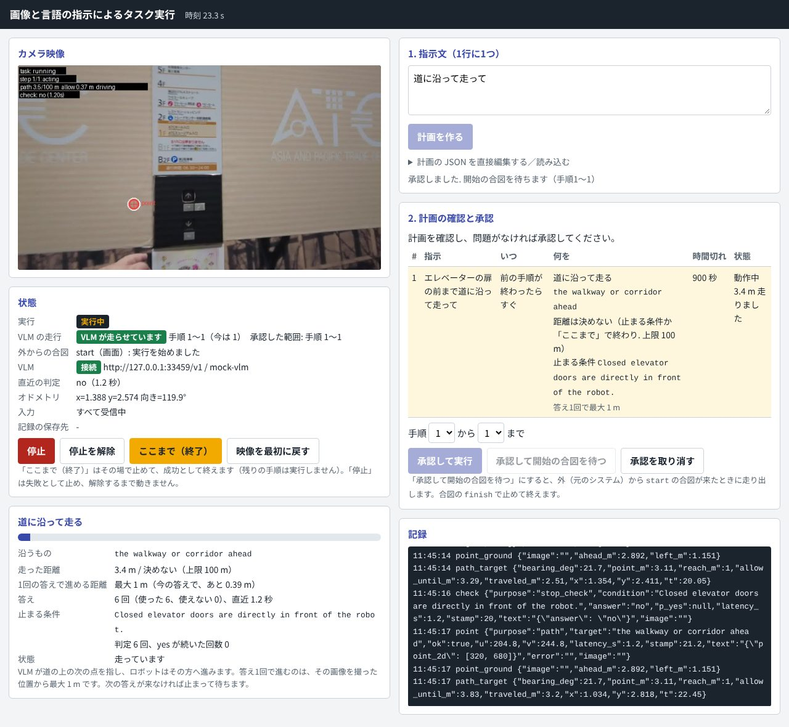

# 道に沿って走る（follow_path）と、途中から・ここまで

「道に沿って走って」の指示で、VLM がカメラの画像を見て道の上の次の点を指し、ロボットがその方へ進みます。コースの途中で VLM に走行を任せ、決めたところで終えて、元のシステム（ROS 1 のナビゲーションなど）に戻す仕組みも入れました。本番（実機）でも使う前提で作っています。



道のベンチ（ATC のコースの映像）で、「エレベーターの扉の前まで道に沿って走って」を走らせているところです（モック VLM）。左下の「道に沿って走る」に、走った距離、1 回の答えで進める距離の残り、答えの数、止まる条件の判定が出ます。

## 1. 1 回の指令で何 m 動くか

| 単位 | 進む距離 | 設定 |
| --- | --- | --- |
| VLM の答え 1 回（道の指差し 1 回） | **最大 1.0 m**。その答えに使った画像を撮った時点の位置から、走った道のりで数える | `skills.follow_path.step_m` |
| 指示 1 つ（計画の 1 手順）で、距離を言ったとき（「道に沿って20m走って」） | その距離（20 m） | 計画の `distance_m` |
| 指示 1 つで、距離も終わりも言わないとき（「道に沿って走って」） | **10 m** | `limits.default_path_distance_m` |
| 指示 1 つで、終わりを言ったとき（「エレベーターの扉の前まで道に沿って走って」「終了の合図まで道に沿って走って」） | 止まる条件が成り立つか、終了の合図まで。ただし **100 m** で止まる | `limits.max_path_distance_m` |

- 次の答えを待つ間も走り続けますが、1.0 m を進み切っても次の答えが来なければ、止まって待ちます。VLM が遅くても、見ていない所を 1.0 m より先へは走りません。
- 平均の速さは、おおよそ「走る速さの上限（0.3 m/s）」と「1.0 m ÷（2 × VLM の 1 回の応答時間）」の小さい方です。擬似世界で測った値は次のとおりです（20 m の曲がり角のある道）。

| VLM の 1 回の応答時間 | 平均の速さ | 道の中心からのずれの最大 |
| --- | --- | --- |
| 0.5 秒 | 0.29 m/s | 0.39 m |
| 1.5 秒 | 0.28 m/s | 0.25 m |
| 3.0 秒 | 0.15 m/s（止まって待つことが増える） | 0.28 m |

## 2. 動き方

1. 新しい画像が届くたびに、VLM に「この道（`path`）の上で、次に進む点を 1 つ指して」と問いかけます。答えは画像の上の点（0〜1000 の相対座標）です。
2. 点を、カメラの取り付け（高さ、下向きの角度）から床の上の点に直します。画像を撮った時点のロボットの位置（オドメトリ）を使うので、推論の間にロボットが進んでいても、ずれません。
3. その点の方へ、最大 1.0 m だけ進んでよいことにします。舵は点の方向に向けて切ります（点が遠ければ 5 m 先に置いた目印に向けて切る）。
4. 向きが 35 度より大きくずれたら、止まって向き直してから進みます。
5. 1〜4 を、走りながらくり返します（問いかけは別のスレッドで続け、答えが届いたら目標を差し替える）。

止まる条件（`stop_when`）があるときは、問いかけの 1 回目と、指差し 1 回ごとに 1 回、その条件を yes / no で判定します。yes が 2 回続いたら止まります。

使わない答え（検査で落とすもの）: 読めない答え、画像の外や端の点、地平線よりはっきり上の点（床ではない）、ロボットの真下（0.3 m より近い）、真横に近い点（60 度より横）。

地平線のすぐ上（画像の高さの 15% まで）を指した答えは、長い道の奥の消える点を指したものとみなし、方向だけを使います（Orin の道のベンチで、まっすぐな歩道では VLM がよく奥の消える点を指したため）。

## 3. 終わり方

| 終わり方 | 結果 | 例 |
| --- | --- | --- |
| 走った道のりが距離（`distance_m`）に達した | 成功 | 「道に沿って 10.0 m 走りました」 |
| 止まる条件に yes が 2 回続いた | 成功 | 「止まる条件が成り立ちました（11.7 m 走りました）」 |
| 終了の合図（画面の「ここまで（終了）」か、ROS の `finish`） | 成功（残りの手順は実行しない） | 「終了の指示（ここまで）で、手順1で止めました」 |
| 距離を決めない手順で、100 m に達した | 成功 | 「距離の上限（100 m）まで走りました」 |
| 停止（画面の「停止」か、ROS の `stop`） | 失敗として止める。解除するまで動かない | |
| 時間切れ（手順の `timeout_s`。道に沿って走る手順は 900 秒） | 失敗 | |
| 使えない答えが 6 回続いた | 失敗 | 「道の指差しが続けて使えません」 |
| 使える答えが 30 秒来ない | 失敗 | カメラか VLM が止まっている |

進めと言っているのに 8 秒進まないとき（点群を見る安全ゲートが人や物で止めている、など）は、画面と記録に「進めません」と出します。そのまま待ち、手順の時間切れまで続けます。

## 4. 指示の書き方

指示文から、VLM が計画（JSON）を作ります。画面の「2. 計画の確認と承認」で中身を確かめてから承認します。

| 指示 | 計画の `do` |
| --- | --- |
| 道に沿って走って | `{"skill": "follow_path", "path": "the walkway", "distance_m": 10, "stop_when": ""}` |
| 道に沿って20m走って | `{"skill": "follow_path", "path": "the walkway", "distance_m": 20, "stop_when": ""}` |
| エレベーターの扉の前まで道に沿って走って | `{"skill": "follow_path", "path": "the walkway", "distance_m": 0, "stop_when": "Closed elevator doors are directly in front of the robot."}` |
| 終了の合図まで道に沿って走って | `{"skill": "follow_path", "path": "the walkway", "distance_m": 0, "stop_when": ""}` |

- `distance_m` が 0 は「距離を決めない」です（止まる条件か終了の合図で終える。上限 100 m）。
- `path` と `stop_when` は英語で書かせます（VLM が英語の方が安定するため）。
- 用意済みの計画: `path_10m.json`、`path_until_elevator_doors.json`、`path_until_finish.json`（画面の「計画の JSON を直接編集する／読み込む」）。

## 5. 途中から・ここまで

コースの途中で VLM に走行を任せ、決めたところで終える方法は 3 つあります。組み合わせて使えます。

| 方法 | 使い方 |
| --- | --- |
| 手順の範囲 | 画面の「手順 [ ] から [ ] まで」で、計画の一部だけを実行する |
| 承認して開始の合図を待つ | 画面で承認しておき、元のシステムが VLM に任せる区間の始まりで `start` を出す。承認は残るので、区間ごとに範囲を変えて何度でも走らせられる（`{"command": "start", "from": 3, "to": 4}`） |
| ここまで | 画面の「ここまで（終了）」か、元のシステムの `finish` で、その場で止めて成功として終える |

### ROS のトピック（ドメイン 42。ROS 1 とは橋渡しでつながる）

| トピック | 型 | 向き | 中身 |
| --- | --- | --- | --- |
| `/vlm_drive/command` | std_msgs/String | 元のシステム → VLM | `start`、`finish`、`stop`。範囲つきの開始は `{"command": "start", "from": 2, "to": 4}` |
| `/vlm_drive/state` | std_msgs/String（JSON） | VLM → 元のシステム | 下の例。変わったときと、2 Hz で出す |
| `/vlm_drive/active` | std_msgs/Bool | VLM → 元のシステム | VLM の指示で走らせている間 true |

```json
{"active": true, "armed": [1, 1], "range": [1, 1], "step": 1, "skill": "follow_path",
 "traveled_m": 3.4, "limit_m": 100.0, "task_state": "running", "result": "", "run": 1,
 "message": "", "source": "ros", "stopped": false, "steps": 1, "plan_ready": true}
```

`result` は終わった後に `done`（完了）、`finished`（ここまでで終了）、`failed`（失敗）、`stopped`（停止）のどれかになります。`run` は走らせた回数で、元のシステムは自分の出した `start` の結果かを、これで見分けられます。

ROS 1 の側から合図を出す例です。

```bash
rostopic pub -1 /vlm_drive/command std_msgs/String "data: 'start'"
```

```bash
rostopic pub -1 /vlm_drive/command std_msgs/String "data: 'finish'"
```

```bash
rostopic echo /vlm_drive/active
```

- 開始の合図は、画面で「承認して開始の合図を待つ」にした計画だけ受けます（`drive.require_arm`）。人が確かめていない計画では走りません。
- 「停止」は承認も取り消します。停止の後は、画面で「停止を解除」を押し、承認し直すまで走りません。

### 速度指令の受け渡し

VLM が走らせていない間、VLM の側（実行系の速度の安全ゲートと、点群を見る安全ゲート）は `/cmd_vel` を出しません（終わったときに 0 を 0.5 秒出してから黙る）。設定は `safety.publish_when_idle: false`（実行系）と `safety: publish_when_idle: false`（点群を見る安全ゲート）です。

元のシステムは、`/vlm_drive/active` が true の間、自分の `/cmd_vel` を出さないでください。両方が出すと、ロボットは 2 つの指令を交互に受けます。元のシステムに速度指令の切り替え（twist_mux など）があるなら、VLM の側の出力を別の名前（例 `/vlm/cmd_vel`）にして切り替えに入れる方が確実です（橋渡しの `CMD_VEL_TOPIC`）。

VLM の側の「停止」は、VLM の側の指令を止めるだけです。ロボット全体の非常停止は、台車の非常停止ボタンで行います。

## 6. 安全

- 障害物で止めるのは、点群を見る安全ゲート（[safety_gate/](../../safety_gate/)）です。VLM の指差しは人やコーンを避けるように頼んでいますが、それで止まることは当てにしません。
- VLM の側で決めている上限: 1 回の答えで 1.0 m、1 手順で 100 m、速さ 0.3 m/s（安全ゲートの上限は 0.5 m/s）、手順の時間切れ 900 秒、使えない答えが 6 回続いたら中止、答えが 30 秒来なければ中止。
- 止まる条件の判定を間違えると、早く止まる（no が正解で yes と答えた）か、止まらない（yes が正解で no と答えた）ことになります。止まらない方が危ないので、本番の前に、使う条件の文を実写で確かめます（7 の机上検証）。止まらなかったときのために、距離の上限か終了の合図を併せて使います。
- ロボットの PC と Orin の時計が合っていないと、画像を撮った時点の位置を引けません。実行系は、オドメトリと画像の時刻のずれを測って直します（`stamp_source: auto`）。ずれていると起動のログに出ます。

## 7. 机上検証

| 検証 | 中身 | 状態 |
| --- | --- | --- |
| 擬似世界の通し試験（`test/test_follow_path.py`） | 道のある擬似世界、モック VLM（HTTP）、実行系をつなぐ。直線と曲がり角で道から外れないか、1 回の答えで 1.0 m を超えて進まないか（答えに 6 秒かかるとき）、止まる条件、ここまで、範囲、使えない答え・来ない答え、Web UI の承認と開始の合図 | 12 件すべて通る。イメージのビルドの中で毎回実行 |
| 実写（ATC のコースの映像）での VLM の評価（`scripts/inside/eval_path.py`） | 33 枚に「走れる範囲」と「避けるもの」、5 つの止まる条件の文に yes / no の正解を付けた（`atc_frames/labels.json`）。本物の VLM に、実行系と同じ問いかけをして、道の上を指す割合、端からの余裕、判定の正しさ、応答時間を測る | Orin（MODE_30W、Qwen3.5-9B）で、道の指差し 33 枚中 32 枚が道の上、止まる条件 50 問中 49 問正解、計画 3 つとも正しい。応答時間は指差し約 4.1 秒（[記録](../../jetson/log/path_eval_20261127_140726_Qwen3.5-9B-quantized.w4a16/report.md)） |
| 道のベンチ（`bench_path`） | 前に走った道のりに合わせて実写の映像を流し、本物の VLM・実行系・安全ゲートを実機と同じトピックでつなぐ。映像は向きを変えても変わらないので、向きを直す動きは確かめられない | モック VLM で GitHub Actions、本物の VLM で Orin。承認して開始の合図を待つ → ROS で start → 道に沿って走る → 止まる条件で止まる、まで動いた。本物の VLM は「エレベーターの扉が目の前」を、扉の横の呼びボタンの壁の前（扉の 12 枚手前）で yes と答えた |

### 実写での評価の動かし方

3090 の PC（先に `scripts/vlm_up.sh`）:

```bash
cd elevator_vlm
```

```bash
bash scripts/vlm_path_eval.sh
```

Orin（電源モードは MAXN にしない。VLM が動いていなければ起動する）:

```bash
bash jetson/bench/path_eval.sh
```

結果は `report.md`（表）と `overlays/`（正解の範囲を緑、避けるものを赤で塗り、VLM の点を描いた画像）に残ります。正解の範囲は目で見て付けたおおよそのものなので、点を描いた画像でも確かめてください。正解を足すときは `atc_frames/labels.json` に書き足します（座標は画像の大きさに対する 0〜1000）。

### 道のベンチの動かし方（Orin）

```bash
BENCH_TASK=path bash jetson/bench/bench_up.sh
```

```bash
BENCH_TASK=path bash jetson/bench/bench_e2e.sh
```

手順は [jetson/bench/](../../jetson/bench/) を参照してください。

## 8. 設定

| 項目 | 既定 | 意味 |
| --- | --- | --- |
| `skills.follow_path.step_m` | 1.0 | VLM の答え 1 回で進める距離の上限 [m] |
| `skills.follow_path.speed` | 0.3 | 速さの上限 [m/s]（`skills.max_linear` も超えない） |
| `skills.follow_path.points_per_check` | 1 | 止まる条件があるとき、指差し何回ごとに 1 回判定するか |
| `skills.follow_path.stop_confirm_count` | 2 | 止まる条件に yes が何回続いたら止まるか |
| `skills.follow_path.turn_in_place_deg` | 35 | 向きのずれがこれより大きければ、止まって向き直す |
| `skills.follow_path.max_point_failures` | 6 | 使えない答えがこれだけ続いたら中止 |
| `skills.follow_path.max_answer_wait_s` | 30 | 使える答えがこれだけ来なければ中止 |
| `skills.follow_path.above_horizon_frac` | 0.15 | 地平線のすぐ上（画像の高さのこの割合まで）の点は、方向だけを使う |
| `limits.default_path_distance_m` | 10 | 距離も終わりも言わない「道に沿って走って」の距離 [m] |
| `limits.max_path_distance_m` | 100 | 1 手順の上限 [m] |
| `drive.command_topic` / `state_topic` / `active_topic` | `vlm_drive/...` | 合図と知らせのトピック。空なら使わない |
| `drive.require_arm` | true | 開始の合図は、承認して待っている計画だけ受ける |
| `drive.disarm_after_start` | false | true なら、合図で 1 回走らせるたびに承認し直す |
| `safety.publish_when_idle` | true（実機とベンチの設定では false） | 走らせていない間も 0 を出し続けるか |
| `perception.path_system` | （英語のプロンプト） | 道の指差しのシステムプロンプト |
| `stamp_source` | auto | 画像とオドメトリの時刻。auto なら時計のずれを直す |

実機の設定は [jetson/robot/task_robot.yaml](../../jetson/robot/task_robot.yaml)、道のベンチの設定は `ros2_ws/src/elevator_sim/config/task_bench_path.yaml` です。

## 9. ファイル

| ファイル | 中身 |
| --- | --- |
| `elevator_task/core/skills.py` | `follow_path`（道に沿って走るスキル）と、問いかけを続けるスレッド |
| `elevator_task/core/perception.py` | 道の指差しの問いかけ（`point_path`、`PATH_SYSTEM`） |
| `elevator_task/core/plan.py`、`planner.py` | 計画の形式と、計画を作るプロンプト |
| `elevator_task/core/executor.py` | 範囲を指定した実行、終了の指示 |
| `elevator_task/core/runtime.py`、`webui.py`、`task_node.py` | 承認して開始の合図を待つ、合図、知らせのトピック、画面 |
| `elevator_task/core/safety.py`、`safety_gate_node.py` | 走らせていない間は黙る |
| `elevator_sim/road_world.py`、`test/test_follow_path.py` | 道のある擬似世界と、通し試験 |
| `elevator_sim/bench_path_node.py`、`frame_labels.py`、`launch/bench_path.launch.py` | 道のベンチ、正解から答えるモック VLM |
| `scripts/inside/eval_path.py` | 実写での評価 |
| `atc_frames/labels.json` | 実写の正解 |
