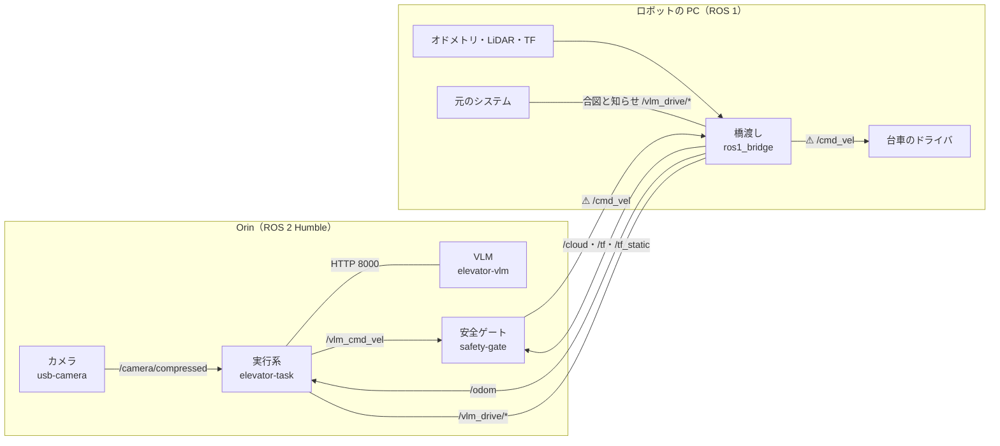

# 実機の手順書（Orin を受け取った人向け）

この Orin には、ロボットに載せて「道に沿って走って」などの指示で VLM（画像と言葉が分かる AI）に走らせるための一式が入っています。この手順書のとおりに、**カメラをつなぎ、ロボットの PC（ROS 1）とつなぎ、VLM の指示で走らせる**ところまで進めます。コースの途中で VLM に走行を任せ、決めたところで元のシステム（ROS 1 のナビゲーション）に戻す使い方を前提にしています。仕組みは [道に沿って走る（follow_path）と、途中から・ここまで](../../elevator_vlm/docs/follow_path.md) を参照してください。

> [!WARNING]
> **最終の速度指令のトピック: `/cmd_vel`（`geometry_msgs/Twist`）**
>
> ロボットへ出る速度の指令は、点群を見る安全ゲート（サービス `safety-gate`）の出力だけです。名前は **`/etc/safety-gate/config.yaml` の `topics.cmd_out`** で決めます。
>
> - ロボットの台車（ROS 1）が速度の指令を受けるトピック（速度の指令の切り替え twist_mux などがあれば、その入力）と、**同じ名前**にします。橋渡し（ros1_bridge）はトピックの名前を変えられません。
> - 変えたら `sudo systemctl restart safety-gate`。今の名前は `bash jetson/robot/robot_up.sh` の最後と `bash jetson/robot/check_link.sh` に出ます。
> - VLM が走らせていない間、安全ゲートは何も出しません（`safety.publish_when_idle: false`。変えないこと）。VLM が走らせている間は、元のシステムから同じトピックに出さないでください。

> [!WARNING]
> **ロボットの足形: `/etc/safety-gate/config.yaml` の `footprint`**
>
> 受け渡しのときは**仮の値**（`base_link` を中心にした、前後 0.70 m × 左右 0.60 m の四角）です。**実機を測って書き換えるまで、走らせないでください。**
>
> - 上から見たロボットの形の頂点を、`base_link` の原点から測って書きます [m]。x が前、y が左です。バンパーや出っ張りも含めます。
> - 安全ゲートは、この形のまわりに `safety.margin`（0.10 m）を足して、ぶつかるかを見ます。
> - 変えたら `sudo systemctl restart safety-gate`。安全ゲートの WebUI（`http://<OrinのIP>:9001/`）で形を確かめます。

## 全体の流れ

| 手順 | すること | 主に使うもの |
| --- | --- | --- |
| [1](#1-orin-の状態を確かめる) | Orin の状態を確かめる | `orin_state.sh` |
| [2](#2-カメラをつなぐ) | カメラをつなぐ | カメラの WebUI（9000）、`ros2.sh` |
| [3](#3-ロボットの-pc-とつなぐ疎通確認) | ロボットの PC とつなぐ（疎通確認） | [link_check.md](link_check.md)、`check_link.sh` |
| [4](#4-安全ゲートを実機に合わせる) | 安全ゲートを実機に合わせる（⚠ 足形、⚠ 最終の速度指令、点群、TF） | `/etc/safety-gate/config.yaml` |
| [5](#5-実行系を起動して動かさずに確かめる) | 実行系を起動して、動かさずに確かめる | `robot_up.sh`、`vlm_drive.py ping` |
| [6](#6-カメラの取り付けを合わせる) | カメラの取り付けを合わせる | `/etc/elevator-task/task.yaml` |
| [7](#7-短い距離で初めて-vlm-に走らせる) | 短い距離で初めて VLM に走らせる | 実行系の WebUI（8080） |
| [8](#8-元のシステムからの合図で走らせる) | 元のシステムからの合図で走らせる | `vlm_drive.py start / finish` |
| [9](#9-コースで使う) | コースで使う | |

困ったら [うまくいかないとき](#うまくいかないとき)。設定の場所は [設定の一覧](#設定の一覧)。

## つながり



- 実行系は、VLM の答えから速度を決め、実行系の中の上限で抑えて `/vlm_cmd_vel` に出します。ロボットへ直接は出しません。
- 安全ゲートは、点群で前の障害物を見て、止めるか遅くしてから、⚠ `/cmd_vel` に出します。
- 元のシステムは、`/vlm_drive/command` で開始（`start`）と終了（`finish`）を合図し、`/vlm_drive/state` と `/vlm_drive/active` で VLM が走っているかを知ります。

## 1. Orin の状態を確かめる

### 受け渡しのときの状態

| 項目 | 状態 |
| --- | --- |
| リポジトリ | `~/physical_ai_for_mobile_robot`（master）。この手順のコマンドは、ここで実行する |
| OS | JetPack 7.2（L4T R39.2.2） |
| 電源モード | MODE_30W（机の上で使っていたもの。ロボットの上では [5-1](#5-1-電源モード) で MAXN にする） |
| ネット | なくても動く（イメージと VLM の重みは入っている）。ネットが要るのは、リポジトリを更新してイメージを作り直すときだけ |
| つないでいないもの | USB カメラ、ロボット（この手順でつなぐ） |
| 設定 | すべて既定のまま。ROS 2 のドメイン 42、⚠ 足形は仮の値、カメラの取り付けは仮の値 |

電源を入れると自動で起動するもの:

| 名前 | 種類 | 中身 | WebUI | 設定 |
| --- | --- | --- | --- | --- |
| `usb-camera` | サービス | USB カメラの映像を `/camera/compressed` に出す。カメラがつながるまで待つ | 9000 | `/etc/usb-camera/camera.env` |
| `safety-gate` | サービス | 点群を見る安全ゲート。`/vlm_cmd_vel` を受け、⚠ `/cmd_vel` に出す。走らせていない間は何も出さない | 9001 | `/etc/safety-gate/config.yaml` |

入っているが、止めてあるもの（[5-2](#5-2-起動する) の `robot_up.sh` で起動します。一度起動すると、電源を入れ直しても自動で起動します。`robot_down.sh` で止めると、次に `robot_up.sh` を実行するまで起動しません）:

| 名前 | 種類 | 中身 | ポート | 設定 |
| --- | --- | --- | --- | --- |
| `elevator-vlm` | コンテナ | VLM のサーバ（vLLM。モデルは Qwen3.5-9B の 4bit 版 `RedHatAI/Qwen3.5-9B-quantized.w4a16`。重みは `~/.cache/huggingface`） | 8000 | `robot_up.sh` の引数（モデル） |
| `elevator-task` | コンテナ | 実行系（計画、指差し、走行、合図。WebUI） | 8080 | `/etc/elevator-task/robot.env`、`/etc/elevator-task/task.yaml` |

入っているイメージ: `elevator-runtime:latest`（実行系）、`safety-gate:latest`、`usb-camera:latest`、`vllm/vllm-openai:v0.22.0-ubuntu2404`。

Orin に入っていないもの: ROS 1 との橋渡し（ロボットの PC の側に置く）、ROS 2 のコマンド（Orin で `ros2` を打つときは `bash jetson/robot/ros2.sh ...`）。

### 今の状態を見る

```bash
cd ~/physical_ai_for_mobile_robot
```

```bash
bash jetson/robot/orin_state.sh
```

「自動で起動するもの」に `usb-camera` と `safety-gate` が `enabled`、`active` と出れば、受け渡しのときのままです。受け渡す前に記録したものは `jetson/log/orin_state_<日時>.md` にあります。

## 2. カメラをつなぐ

1. USB カメラを Orin の USB の口に挿します（USB 3 の口がよい）。カメラのサービスが自動で見つけます。
2. ブラウザで映像が出るかを見ます: `http://<OrinのIP>:9000/`（Orin の IP は `hostname -I`）。離れた PC から SSH でつないでいるときは、つなぐときに `-L 8080:localhost:8080 -L 9000:localhost:9000 -L 9001:localhost:9001` を付けると、手元のブラウザの `http://localhost:9000/` などで見られます。
3. トピックに出ているかを見ます（30 前後と出る。Ctrl+C で止める）。

```bash
bash jetson/robot/ros2.sh topic hz /camera/compressed
```

4. カメラの**水平画角**（横に何度写るか）を、カメラの仕様書で調べておきます。[6](#6-カメラの取り付けを合わせる) で使います。

映像が出ないとき:

```bash
journalctl -u usb-camera -n 30
```

「カメラがつながるのを待っています」が続くなら挿し直します。カメラを 2 台以上つなぐときや、別のカメラが選ばれるときは、`/etc/usb-camera/camera.env` の `CAMERA_DEVICE` に `/dev/v4l/by-id/...-video-index0` の名前を書きます（名前は `ls /dev/v4l/by-id/`）。書き換えたら起動し直します。

```bash
sudo systemctl restart usb-camera
```

詳しくは [jetson/camera/](../camera/)。

## 3. ロボットの PC とつなぐ（疎通確認）

詳しい手順は **[link_check.md](link_check.md)** です。ロボットの PC にすでに橋渡しがあれば（Foxy 用など）、それを使えます。流れだけ書きます。

1. Orin とロボットの PC を LAN でつなぎ、`ping` が通るようにする
2. ロボットの PC の橋渡しを調べる（種類、ROS 2 のドメイン、型。[link_check.md の 2](link_check.md#2-ロボットの-pc-すでにある橋渡しを調べる)）
3. Orin の ROS 2 のドメインを、橋渡しにそろえる（例: 橋渡しが 0 なら）

```bash
bash jetson/robot/set_domain.sh 0
```

4. トピックの名前を、ロボットの名前にそろえる（オドメトリ、点群、⚠ 最終の速度指令。[設定の一覧](#設定の一覧)）
5. Orin から確かめる。`[NG]` がなくなるまで直す

```bash
bash jetson/robot/check_link.sh
```

> [!CAUTION]
> 橋渡しは 1 つだけ動かします。すでにある橋渡しを使うなら、このリポジトリの橋渡し（[ros1_bridge/](../../ros1_bridge/)）は入れません。

## 4. 安全ゲートを実機に合わせる

設定ファイルを開きます。

```bash
sudo nano /etc/safety-gate/config.yaml
```

| 項目 | 書くもの |
| --- | --- |
| ⚠ `footprint` | ロボットの足形。上の ⚠ のとおり、実機を測った値 |
| ⚠ `topics.cmd_out` | 台車が受ける速度の指令のトピック（ふつうは `/cmd_vel`） |
| `topics.cloud` | 点群のトピック（ロボットの PC で `rostopic list`） |
| `frames.base` | ロボットの座標系の名前（ふつうは `base_link`） |
| `frames.cloud` | 点群の座標系。空なら点群のヘッダの名前を使う |
| `tf:` | `base_link` ← 点群の座標系の TF が、ロボットの PC から来ないときだけ、`publish_static: true` にして `parent`、`child`、`xyz`（位置 [m]）、`rpy`（向き [rad]）を書く |
| `height_range` | 障害物として見る高さ（`base_link` の z。既定 0.05〜1.5 m）。床や天井が障害物に見えるなら狭める |

`topics.cmd_in`（`/vlm_cmd_vel`）と `safety.publish_when_idle`（`false`）は変えません。書き換えたら起動し直します。

```bash
sudo systemctl restart safety-gate
```

確かめ方:

- 安全ゲートの WebUI（`http://<OrinのIP>:9001/`）に、ロボットの足形と、まわりの点群が出る。ロボットの前に箱を置くと、その位置に障害物が出る
- `bash jetson/robot/check_link.sh` の「TF」と「安全ゲートから見た点群」が `[OK]`。足形の大きさ（前・後・左・右）が実機と合っている

## 5. 実行系を起動して、動かさずに確かめる

ロボットの電源を入れ、元のシステム（roscore、ロボット、橋渡し）が動いている状態にします。ロボットは止めておきます。

### 5-1. 電源モード

ロボットの電源が Orin の MAXN（最大）に足りるなら、MAXN にします（VLM の答えが速くなり、止まらずに進みやすくなる）。机の上の電源では、MAXN で電流が足りずに落ちたことがあります。

```bash
sudo nvpmodel -m 0
```

今のモードは `bash jetson/robot/orin_state.sh` の「電源モード」に出ます。

### 5-2. 起動する

```bash
bash jetson/robot/robot_up.sh
```

初めてのときは、実行系の設定 `/etc/elevator-task/robot.env` と `/etc/elevator-task/task.yaml` を作ります（sudo のパスワードを聞かれることがある）。VLM の起動には数分かかります。最後に、ROS 2 のドメイン、オドメトリのトピック、⚠ 最終の速度指令のトピックと、WebUI の場所が出ます。

| WebUI | URL | 見るところ |
| --- | --- | --- |
| 実行系 | `http://<OrinのIP>:8080/` | 「入力」が「すべて受信中」、「VLM」が「接続」 |
| 安全ゲート | `http://<OrinのIP>:9001/` | 点群とロボットの足形が出て、判定が `IDLE`。理由に「速度指令は出していません. 元のシステムに任せています」 |
| カメラ | `http://<OrinのIP>:9000/` | 映像が出る |

### 5-3. もう一度、つながりを確かめる

実行系が動いているので、知らせと合図も確かめられます。

```bash
bash jetson/robot/check_link.sh
```

ロボットの PC で（ROS 1 の setup.bash を読み込んだ端末で）、合図が届くか（`ping` は何もしない合図。[link_check.md の 6](link_check.md#6-ロボットの-pc-届くかを確かめる)）:

```bash
python3 vlm_drive.py ping
```

`vlm_drive.py` は [ros1_bridge/tools/vlm_drive.py](../../ros1_bridge/tools/vlm_drive.py) です。USB メモリなどでロボットの PC に置きます。

### 5-4. 速度の通り道を、0 の指令で確かめる

ロボットを止めたまま（非常停止を押しておくと確実）、元のシステムのナビゲーションも止めて、ロボットの PC で `rostopic echo /cmd_vel` を見ながら、Orin で:

```bash
bash jetson/robot/check_link.sh --zero
```

ロボットの PC に 0 の指令が 3 秒ほど出れば、実行系の出口から台車までがつながっています（[link_check.md の 6-3](link_check.md#6-3-速度の指令orin--ros-1--台車)）。

## 6. カメラの取り付けを合わせる

VLM が指した画像の上の点を、床の上の点に直すのに使います。実機で測って書き換えます。

```bash
sudo nano /etc/elevator-task/task.yaml
```

`camera:` の下:

| 項目 | 測るもの |
| --- | --- |
| `height_m` | 床からレンズの中心までの高さ [m] |
| `pitch_deg` | 下向きの角度 [度]。水平なら 0 |
| `x_offset_m` | ロボットの中心（`base_link`。ふつうは駆動輪の軸の真ん中）からレンズまでの前後の距離 [m]。前が + |
| `y_offset_m` | 同じく左右 [m]。左が +。真ん中なら 0 |
| `hfov_deg` | カメラの水平画角 [度]（仕様書の値）。カメラの校正ファイルがないときに使う（`check_link.sh` の「カメラ情報」が「校正なし」なら使われている） |

書き換えたら、実行系だけ起動し直します。

```bash
bash jetson/robot/robot_up.sh
```

確かめ方: ロボットの前、ちょうど 2 m の床に目印（テープなど）を置きます。台車の非常停止を押してロボットが動かないようにしてから、実行系の画面の「計画の JSON を直接編集する／読み込む」に次の計画を貼って読み込み、「承認して実行」を押します。

```json
{"steps": [{"instruction": "床の目印の上", "when": {"type": "now"},
  "do": {"skill": "go_to_visual_target", "target": "the tape mark on the floor"}, "timeout_s": 30}]}
```

記録の欄の `point_ground` の `ahead_m` が 2.0 前後なら合っています（ロボットは動けないので、その後「発進できない」で止まります）。大きくずれていたら `pitch_deg` を直します（遠く出るなら角度を大きく）。

## 7. 短い距離で初めて VLM に走らせる

- ⚠ 足形を実機の値にしたか（[4](#4-安全ゲートを実機に合わせる)）、⚠ 最終の速度指令が台車に届くか（[5-4](#5-4-速度の通り道を0-の指令で確かめる)）を確かめてから行います。
- 周りに人や物がない、広くまっすぐな通路で行います。
- 台車の非常停止をすぐ押せる人が付きます。画面の「停止」は VLM の側を止めるだけです。
- 元のシステムのナビゲーションは止めておきます（`/cmd_vel` を出さない状態）。

1. 実行系の画面で「計画の JSON を直接編集する／読み込む」を開き、「用意済み: path_10m.json」を押す
2. 計画の表に「道に沿って走る … 10 m 走ったら終わり … 答え 1 回で最大 1 m」と出ているのを確かめる
3. 「承認して実行」を押す
4. 左下の「道に沿って走る」で、走った距離、答えの数と応答時間を見る。途中でやめるときは「ここまで（終了）」

確かめること:

| 項目 | 期待 |
| --- | --- |
| 動き | 道の真ん中あたりを進む。答えを待つ間は止まり、また進む |
| 安全ゲートの画面 | 走っている間は `PASS`。前に人が立つと `SLOW` か `STOP` で止まる（人が試すときは、ゆっくり近づく） |
| 終わった後 | 安全ゲートが `IDLE` に戻り、「速度指令は出していません」（何も出さない） |
| 応答時間（画面の「直近 ○ 秒」） | MAXN で 2 秒以下なら、ほぼ止まらずに進む |

VLM の答え 1 回で進むのは、最大 1 m です（その画像を撮った位置から。`skills.follow_path.step_m`）。次の答えが来るまでは止まって待ちます。

## 8. 元のシステムからの合図で走らせる

1. 実行系の画面で計画を読み込み、「承認して開始の合図を待つ」を押す（「VLM の走行」が「開始の合図を待っています」になる）
2. ロボットの PC から開始の合図を出す

```bash
python3 vlm_drive.py start
```

3. 走っている間は `/vlm_drive/active` が true。終えるときは `finish` を出す（距離や止まる条件で先に終わることもある）

```bash
python3 vlm_drive.py finish
```

様子を出し続けるとき（Ctrl+C で終わる）:

```bash
python3 vlm_drive.py state
```

4. 終わり方は `/vlm_drive/state` の `result`（`done` 完了、`finished` 合図で終了、`failed` 失敗、`stopped` 停止）

`rostopic pub -1 /vlm_drive/command std_msgs/String "data: 'start'"` でも合図を出せます。ただし、橋渡しが dynamic_bridge のときは 1 回目を落とすことがあるので、`vlm_drive.py` を使います（[link_check.md の 2-4](link_check.md#2-4-dynamic_bridge-の注意)）。

元のシステムに組み込むときの約束:

- VLM に任せる区間の始まりで、自分の `/cmd_vel` を止めてから `start` を出す。
- `/vlm_drive/active` が true の間は `/cmd_vel` を出さない。false に戻ったら、`/vlm_drive/state` の `result` を見て再開する。
- 合図の Publisher は起動のときに作っておく（dynamic_bridge でも 1 回目を落とさない）。
- 承認は残るので、区間ごとに範囲を変えて何度でも走らせられる。範囲つきの合図は JSON で出す（例: 手順 2〜3）。

```bash
python3 vlm_drive.py start 2 3
```

## 9. コースで使う

- 机上検証で道を指せた場面（屋外の歩道、屋内の通路、スロープなど）を、VLM に任せる区間の候補にします。
- 止まる条件の文は、なるべく具体的にします。ベンチでは「エレベーターの扉が目の前」が、扉の横の呼びボタンの壁の前で成り立ちました。止める場所をはっきりさせるなら、例えば「The closed metal doors of an elevator fill the center of the image, less than 2 m away.」のように書きます。新しい文は、実写で確かめてから使います（[jetson/bench/](../bench/) の 8.）。
- 止まる条件が成り立たなかったときのために、距離（`distance_m`）か `finish` を併せて使います。
- 区間ごとの計画を 1 つの計画にまとめて承認しておくと、元のシステムは `from`・`to` で区間を選べます。

## 設定の一覧

実機の設定は、Orin の `/etc` の下の 4 つのファイルにまとまっています。リポジトリを `git pull` しても上書きされません。書き換えるには `sudo` が要ります（例 `sudo nano /etc/safety-gate/config.yaml`）。

| ファイル | 持ち主 | 書き換えたら | 雛形（初めのもの） |
| --- | --- | --- | --- |
| `/etc/safety-gate/config.yaml` | 安全ゲート | `sudo systemctl restart safety-gate` | [safety_gate/.../config/config.yaml](../../safety_gate/ros2_ws/src/safety_gate/config/config.yaml) |
| `/etc/elevator-task/robot.env` | 実行系 | `bash jetson/robot/robot_up.sh` | [robot.env](robot.env) |
| `/etc/elevator-task/task.yaml` | 実行系 | `bash jetson/robot/robot_up.sh` | [task_robot.yaml](task_robot.yaml) |
| `/etc/usb-camera/camera.env` | カメラ | `sudo systemctl restart usb-camera` | [jetson/camera/camera.env](../camera/camera.env) |

### ロボットの PC（ROS 1）の名前に合わせるもの

橋渡しはトピックの名前を変えられないので、Orin の側を、ロボットの名前に合わせます。

| もの | ファイル | 項目 | 既定 |
| --- | --- | --- | --- |
| ⚠ 台車が受ける速度の指令 | `/etc/safety-gate/config.yaml` | `topics.cmd_out` | `/cmd_vel` |
| オドメトリ（`nav_msgs/Odometry`） | `/etc/elevator-task/robot.env` | `ODOM_TOPIC` | `/odom` |
| 点群（`sensor_msgs/PointCloud2`） | `/etc/safety-gate/config.yaml` | `topics.cloud` | `/cloud` |
| ロボットの座標系 | `/etc/safety-gate/config.yaml` | `frames.base` | `base_link` |
| 点群の座標系 | `/etc/safety-gate/config.yaml` | `frames.cloud` | 空（点群のヘッダの名前） |
| 合図と知らせ | `/etc/elevator-task/task.yaml` | `drive.command_topic`、`state_topic`、`active_topic` | `/vlm_drive/command`、`/vlm_drive/state`、`/vlm_drive/active` |
| ROS 2 のドメイン | 3 か所（下） | `bash jetson/robot/set_domain.sh <番号>` でまとめて変える | 42 |

ROS 2 のドメインは、`/etc/elevator-task/robot.env` の `ROS_DOMAIN_ID`、`/etc/safety-gate/config.yaml` の `ros_domain_id`、`/etc/usb-camera/camera.env` の `ROS_DOMAIN_ID` の 3 か所にあります。1 か所だけ変えるとつながらなくなるので、`set_domain.sh` で変えます。

### ロボットに合わせて測るもの

| もの | ファイル | 項目 | 既定（仮の値） |
| --- | --- | --- | --- |
| ⚠ 足形 | `/etc/safety-gate/config.yaml` | `footprint` | 前後 0.70 m × 左右 0.60 m の四角 |
| 点群の取り付け（TF が来ないときだけ） | `/etc/safety-gate/config.yaml` | `tf.publish_static`、`xyz`、`rpy` | false、`[0, 0, 0.5]`、`[0, 0, 0]` |
| カメラの高さ、下向きの角度、位置 | `/etc/elevator-task/task.yaml` | `camera.height_m`、`pitch_deg`、`x_offset_m`、`y_offset_m` | 0.50 m、15 度、0.20 m、0 m |
| カメラの水平画角 | `/etc/elevator-task/task.yaml` | `camera.hfov_deg` | 90 度 |

### 速さ

速さの上限は 3 か所にあり、いちばん小さいものが効きます。速くするときは 3 つとも見ます。

| どこ | ファイル | 項目 | 既定 |
| --- | --- | --- | --- |
| 実行系が出す速さ | `/etc/elevator-task/task.yaml` | `skills.follow_path.speed`（道に沿って走る）、`skills.max_linear`、`skills.max_angular`（ほかの動き） | 0.3 m/s、0.3 m/s、0.8 rad/s |
| 実行系の中の上限 | `/etc/elevator-task/task.yaml` | `safety.max_linear`、`safety.max_angular` | 0.5 m/s、1.2 rad/s |
| 安全ゲートの上限 | `/etc/safety-gate/config.yaml` | `limits.max_linear_x`、`limits.max_angular_z` | 0.5 m/s、1.0 rad/s |

### 安全ゲートの判定

| 項目（`/etc/safety-gate/config.yaml`） | 既定 | 意味 |
| --- | --- | --- |
| `safety.margin` | 0.10 m | 足形のまわりの余裕 |
| `safety.time_horizon` | 2.0 s | 指令のまま何秒先まで動くかを見る |
| `safety.stop_time` | 0.5 s | これより早くぶつかるなら止める。遅ければ速度を落とす |
| `safety.cloud_timeout` | 0.5 s | 点群がこれより長く来なければ止める |
| `height_range.min_z`、`max_z` | 0.05 m、1.5 m | 障害物として見る高さ |
| `safety.publish_when_idle` | false | **変えない**。true にすると、VLM が走らせていない間も 0 を出し続け、元のシステムの指令とぶつかる |
| `topics.cmd_in` | `/vlm_cmd_vel` | **変えない**。実行系の出口（`robot_up.sh` が決めている） |

### VLM の走り方

| 項目（`/etc/elevator-task/task.yaml`） | 既定 | 意味 |
| --- | --- | --- |
| `skills.follow_path.step_m` | 1.0 m | VLM の答え 1 回で進む距離の上限。応答が遅く、止まってばかりなら 1.5 |
| `limits.default_path_distance_m` | 10 m | 「道に沿って走って」で距離も止まる条件も言わないときの距離 |
| `limits.max_path_distance_m` | 100 m | 道に沿って走る 1 手順の上限 |
| `skills.follow_path.stop_confirm_count` | 2 | 止まる条件に yes が何回続いたら止まるか |
| `drive.require_arm` | true | 開始の合図は、画面で「承認して開始の合図を待つ」にした計画だけ受ける |

ほかの項目は [follow_path.md の 8](../../elevator_vlm/docs/follow_path.md) を参照してください。

### カメラ

| 項目（`/etc/usb-camera/camera.env`） | 既定 | 意味 |
| --- | --- | --- |
| `CAMERA_DEVICE` | auto | カメラの機器。auto なら USB のカメラを探す |
| `CAMERA_WIDTH`、`CAMERA_HEIGHT`、`CAMERA_FPS` | 640、480、30 | 解像度とコマ数 |
| `CAMERA_COMPRESSED_TOPIC` | `/camera/compressed` | 出すトピック（変えたら `task.yaml` の `camera.image_topic` も） |
| `CAMERA_INFO_URL` | 空 | カメラの校正ファイル。なければ `hfov_deg` を使う |
| `CAMERA_WEB_PORT` | 9000 | WebUI のポート |

### VLM のモデル

既定は `RedHatAI/Qwen3.5-9B-quantized.w4a16`（入っているのはこれだけ）。別のモデルは、ネットのあるところで `bash jetson/robot/robot_down.sh --all` の後に `bash jetson/robot/robot_up.sh <モデル>` で落として起動します。

### 使うポート

| ポート | もの |
| --- | --- |
| 8000 | VLM の API（Orin の中だけで使う） |
| 8080 | 実行系の WebUI |
| 9000 | カメラの WebUI |
| 9001 | 安全ゲートの WebUI |

## スクリプト

| コマンド | すること |
| --- | --- |
| `bash jetson/robot/robot_up.sh` | VLM と実行系を起動する（設定を変えたときも、これで起動し直す） |
| `bash jetson/robot/robot_down.sh` | 実行系を止める（`--all` で VLM も） |
| `bash jetson/robot/check_link.sh` | つながりを確かめる（`--zero` で速度 0 を流す、`--save` で記録） |
| `bash jetson/robot/ros2.sh <引数>` | Orin で `ros2` コマンドを使う（例 `topic list`、`topic hz /odom`） |
| `bash jetson/robot/set_domain.sh <番号>` | ROS 2 のドメインを 3 か所まとめて変える |
| `bash jetson/robot/orin_state.sh` | 状態を見る（`--save` で記録） |
| `python3 vlm_drive.py <合図>` | ロボットの PC から合図を出す（`ping`、`start`、`finish`、`stop`、`state`） |

## 止める・電源

実行系だけを止めます。

```bash
bash jetson/robot/robot_down.sh
```

VLM のサーバも止めるときは `--all` を付けます。

```bash
bash jetson/robot/robot_down.sh --all
```

| 電源を入れ直したとき | 起動するもの |
| --- | --- |
| `robot_up.sh` の後（止めていない） | カメラ、安全ゲート、VLM、実行系（計画と承認は消えるので、画面で読み込み直す） |
| `robot_down.sh --all` の後 | カメラ、安全ゲートだけ |

電源を切るときは、ふつうに `sudo poweroff` で構いません。

## 記録

VLM に渡した画像、問いと答え、経過は `elevator_vlm/runs/<日時>/` に残ります。共有するときは、そのフォルダを `jetson/log/` にコピーしてコミットします。つながりの確かめ（`check_link.sh --save`）と状態（`orin_state.sh --save`）は `jetson/log/` に直接残ります。

## うまくいかないとき

| ようす | 見るところ |
| --- | --- |
| 「オドメトリが未受信」 | `bash jetson/robot/check_link.sh`。名前（`/etc/elevator-task/robot.env` の `ODOM_TOPIC`）、ドメイン、橋渡し（[link_check.md](link_check.md)） |
| 「カメラ画像が未受信」 | `systemctl status usb-camera`、ブラウザで `http://<OrinのIP>:9000/`（[2](#2-カメラをつなぐ)） |
| 起動のログに「時刻が … 秒ずれています」 | ロボットの PC と Orin の時計が合っていない。直して使うので動くが、時計を合わせるのが確実 |
| 安全ゲートが `STOP` のまま | 理由の欄（「TF がありません」「点群が途切れました」）。`journalctl -u safety-gate -f`、`check_link.sh` の TF と点群 |
| 走らせていない間、元のシステムの指令でロボットが動かない | 安全ゲートの設定に `publish_when_idle: false` があるか（`robot_up.sh` が注意を出す） |
| VLM が走らせても、ロボットが動かない | ⚠ `topics.cmd_out` が台車の受ける名前か。`check_link.sh --zero` と、ロボットの PC の `rostopic echo /cmd_vel`（[5-4](#5-4-速度の通り道を0-の指令で確かめる)） |
| 「道の指差しが続けて使えません」で止まる | 記録の `path_point_rejected` の理由。「近すぎます」が多ければ [6](#6-カメラの取り付けを合わせる) のカメラの取り付けを見直す |
| 進みが遅い | 電源モード（[5-1](#5-1-電源モード)）、画面の応答時間。遅いままなら `/etc/elevator-task/task.yaml` の `skills.follow_path.step_m` を 1.5 にする |
| 開始の合図で走らない | 画面で「承認して開始の合図を待つ」を押したか、「停止」のままでないか。画面の「外からの合図」の欄と、`vlm_drive.py` の答えに理由が出る |
| `robot_up.sh` が「イメージが、リポジトリの今の中身から作ったものではありません」 | `git pull` の後に作り直していない。ネットのあるところで `ROBOT_REBUILD=1 bash jetson/robot/robot_up.sh` |
| 「ROS 2 のドメインが違います」 | `bash jetson/robot/set_domain.sh <番号>` |

## これまでに確かめたこと

| 項目 | 結果 |
| --- | --- |
| 実写（ATC のコース）での VLM の机上検証（Orin、MODE_30W、Qwen3.5-9B） | 道の指差し 33 枚中 32 枚が道の上（外れた 1 枚も奥の床を指していた）。止まる条件 50 問中 49 問正解。計画 3 つとも正しい。応答時間は指差し約 4.1 秒、判定約 2.3 秒（[記録](../log/path_eval_20261127_140726_Qwen3.5-9B-quantized.w4a16/report.md)） |
| 道のベンチ（Orin、本物の VLM） | 承認して開始の合図を待つ → ROS で `start` → 道に沿って走る → 止まる条件で止まる → 知らせのトピック、まで動いた。止まる条件「エレベーターの扉が目の前」は、扉の横の呼びボタンの壁の前（扉の 12 枚手前）で成り立った（早く止まる側） |
| 実機 | まだ（この手順書で行う） |

MODE_30W では 1 回の答えに約 4 秒かかるので、止まって待ちながら進みます（平均 0.12〜0.16 m/s）。ロボットの上で MAXN にできれば、速くなる見込みです。

## 渡す人の準備（次に渡すときも）

ネットのあるところで、渡す前に行います。

1. リポジトリを最新にする

```bash
cd ~/physical_ai_for_mobile_robot
```

```bash
git pull
```

2. 実行系のイメージを作り直し、`/etc/elevator-task/` を作る（数分〜十数分。カメラやロボットがなくてよい。「まだ準備ができていません」と出てよい）

```bash
ROBOT_REBUILD=1 bash jetson/robot/robot_up.sh
```

3. VLM と実行系を止める（受け取った人が `robot_up.sh` で起動する）

```bash
bash jetson/robot/robot_down.sh --all
```

4. 状態を記録して、コミットする

```bash
bash jetson/robot/orin_state.sh --save
```

```bash
git add jetson/log
```

```bash
git commit -m "受け渡しのときの Orin の状態"
```

```bash
git push
```
